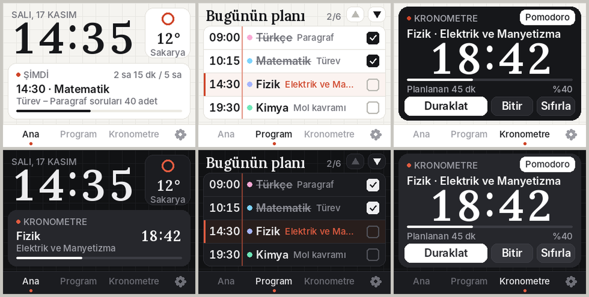

# Masa saati yazılımı (ESP32 CYD)

ESP32-2432S028R ("Cheap Yellow Display") için. Ekstra parça gerekmez: kart, USB kablosu ve
powerbank yeterli.

## Ekranlar

| Ekran | Ne gösterir |
| --- | --- |
| **Ana** | Saat, tarih, Sakarya hava durumu, şimdiki/sıradaki oturum, günlük hedef çubuğu |
| **Program** | Günün planı. Sağdaki daireye dokun: tamamlandı / geri al. Satıra dokun: o dersle kronometre |
| **Kronometre** | Başlat / Duraklat, Bitir (telefona oturum olarak gider), Sıfırla, Pomodoro (25 dk'da mola uyarısı) |
| **Ayarlar** (dişli) | Wi-Fi ve hesap, dokunmatik ayarı, tema, renkleri ters çevirme, güncelleme, bağlantı bilgisi |

**BOOT tuşu:** kısa bas → sonraki ekran, 2 saniye bas → Ayarlar.

**Işık:** yeşil = kronometre çalışıyor, mavi yanıp sönme = 2 dk içinde oturum başlıyor ya da
Pomodoro molası, kırmızı = buluta bağlanamıyor. Ekran 22:00–07:00 arası kısılır; ilk dokunuş
yalnızca ekranı açar.

**Tema:** telefondaki uygulamayla aynı "Sentez" tasarımı. *Otomatik* (varsayılan) gündüz açık
kâğıt, 22:00–07:00 arası koyu görünüm kullanır. Ayarlar → *Tema* satırına her dokunuş
Otomatik / Açık / Koyu arasında geçer.

## İlk yükleme (telefondan, OTG ile)

1. [Releases](https://github.com/loljpg/calisma-asistan-/releases) sayfasından en yeni
   **fw-v…** sürümündeki `ilk-kurulum-cyd.bin` dosyasını indir.
2. Play Store'dan **ESPFlash** uygulamasını kur. Kartı OTG kablosuyla telefona bağla, USB
   iznini ver.
3. Dosyayı seç, adres **0x0**, hız 460800 (olmazsa 115200). Yaz.
4. Bağlanamazsa: kartta **BOOT** tuşunu basılı tut, **RST**'ye bir kez bas, BOOT'u bırak ve
   tekrar dene.

Ekran beyaz kalır, karışık görünür ya da renkler ters olursa aynı adımlarla
`ilk-kurulum-cyd_st7789.bin` dosyasını yükle (iki USB girişli bazı kartlar bu sürücüyü kullanır).
Sadece renkler ters ise Ayarlar → *Renkleri ters çevir* yeterli.

## İlk açılış

1. **Dokunmatik ayarı:** ekrandaki üç artının ortasına sırayla dokun (BOOT ile atlanabilir).
2. **Kurulum portalı:** telefonun Wi-Fi listesinde `CalismaSaati-Kurulum` ağına bağlan. Açılan
   sayfada *Configure WiFi* → ev ağını seç, şifresini yaz. Altta Firebase alanlarını doldur:
   - Veritabanı adresi: `https://…firebasedatabase.app`
   - Web API anahtarı (uygulamadaki ile aynı)
   - Uygulamada kullandığın e-posta ve şifre
3. *Save*'e bas. Kart ağa bağlanır, saat ve hava durumu gelir, plan telefondan çekilir.

Sayfa kendiliğinden açılmazsa tarayıcıda `192.168.4.1` adresine git. Bilgileri sonradan
Ayarlar → *Wi-Fi ve hesap ayarları* ile değiştirebilirsin (şifre alanı boş kalırsa eski şifre
korunur).

## Güncellemeler

Kart Wi-Fi'deyken 12 saatte bir (ve açılıştan kısa süre sonra) GitHub'daki en yeni **fw-v…**
sürümünü denetler, varsa kendisi indirip kurar. Ayarlar → *Güncellemeyi denetle* ile hemen de
deneyebilirsin. Tekrar OTG ile yüklemen gerekmez.

## Telefonla eşleşme nasıl çalışır?

Ayrıntılar: [docs/firebase.md](../docs/firebase.md).

- Telefon günün planını `device/view` altına yazar; kart 30 saniyede bir okur.
- Kart tik ve kronometre oturumlarını `device/events` altına gönderir; telefon uygulaması
  açıldığında bunları işler ve siler. Kart kendi değişikliklerini beklemeden hemen gösterir.
- İnternet yoksa olaylar kartta saklanır, bağlantı gelince gönderilir.
- Kart dakikada bir `device/status` yazar; telefondaki "Masa saati bağlı" yazısı buradan gelir.

## Geliştirme notları

- PlatformIO, `espressif32@6.9.0` (Arduino core 2.0.x). Ortamlar: `cyd` (ILI9341), `cyd_st7789`.
- Türkçe harfler için yazı tipleri `tools/make_fonts.py` ile üretilir (`src/fonts.h`):
  arayüz Inter, başlıklar ve büyük rakamlar Lora. İkisi de SIL Open Font License 1.1.
- Derleme ve sürüm yayınlama `.github/workflows/firmware.yml` ile GitHub'da yapılır.
